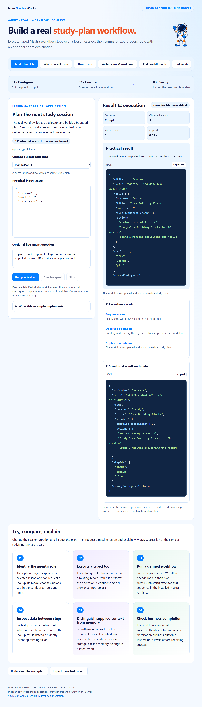

# Mastra · Lesson 04 · Core Building Blocks

Execute typed Mastra workflow steps over a lesson catalog, then compare fixed process logic with an optional agent explanation.



## What this application does

The real workflow looks up a lesson and builds a bounded plan. A missing catalog record produces a clarification outcome instead of an invented prerequisite.

**Practical mode:** Real Mastra workflow execution · no model call.

The local path executes a real two-step Mastra workflow and deterministic planning logic. It does not call a model or persist conversation history. The separately labelled live agent uses the same bounded catalog.

## Run the application

Use **Node.js 24+**. Each lesson is an independent repository with its own dependency lockfile.

```powershell
git clone https://github.com/luiscoco/Udemy-Mastra-lesson04-app.git
cd Udemy-Mastra-lesson04-app
npm ci
npm start
```

Open **http://127.0.0.1:3204** and choose **Run practical lab**. The practical operation requires no model key. Starting the server does not make a provider request. Keep the terminal open; Ctrl+C stops it. To change the port, set PORT in the environment or local .env file.

## Application pages

| Page | Content |
| --- | --- |
| Application lab | Editable JSON cases, actual execution, formatted result, event log and structured metadata |
| What you will learn | Lesson objectives, comprehension checks and a concrete exercise |
| How to run | Installation, local/live modes, commands and troubleshooting |
| Architecture & workflow | The practical execution sequence and the actual request runner |
| Code walkthrough | Source-derived excerpts with GitHub line references |

The application supports light/dark themes, mobile layouts, sanitized Markdown, syntax-highlighted code and copy-code controls.

## Practical execution workflow

| Stage | Source | Actual behavior |
| --- | --- | --- |
| Validate request | [src/mastra/workflows.ts](src/mastra/workflows.ts) | Validate lessonId, bounded session minutes and optional recentLesson context. |
| Create run | [src/lab.ts](src/lab.ts) | Call the registered studyPlan workflow’s createRun() and start(). |
| Lookup step | [src/mastra/workflows.ts](src/mastra/workflows.ts) | Execute the typed catalog tool and pass its nullable record forward. |
| Plan step | [src/mastra/workflows.ts](src/mastra/workflows.ts) | Build study actions or a needs-clarification outcome from the actual lookup result. |

The browser posts JSON to **POST /api/lab**. The host validates the envelope, runs the lesson implementation and sends NDJSON events. The UI renders the actual result and a separate application outcome. **GET /api/config** exposes public lesson metadata and credential-presence readiness, never credential values.

## Classroom cases and expected outcomes

### 1. Plan lesson 4

```json
{
  "lessonId": 4,
  "minutes": 25,
  "recentLesson": 3
}
```

**Expected:** A successful workflow with a concrete study plan.

### 2. Missing lesson record

```json
{
  "lessonId": 999,
  "minutes": 25,
  "recentLesson": 3
}
```

**Expected:** A completed workflow whose business result asks for a valid lesson.

## Interpreting the result

- SDK status success with outcome=needs-clarification is shown as Needs attention.
- No conversation memory is configured or retained by this example.

**Complete** means the operation met its implemented completion checks. **Needs attention** exposes a business, format or validation finding. **Could not finish** is an execution/request failure. **Cancelled** is a separate user action. Read the evidence before treating any runtime status as task correctness.

## Optional live-agent workflow

1. The same real workflow runs first.
2. The registered tutor explains its returned evidence; recentLesson is explicitly request context.

The live button uses **POST /api/query** and a real provider, and may incur API usage. Tests use an explicit SDK model adapter; no paid provider call is claimed by the test evidence.

Configure your own credentials locally, preserving any existing .env:

```powershell
if (!(Test-Path .env)) { Copy-Item .env.example .env }
notepad .env
```

```dotenv
# Set your own provider credential locally. No credential is copied from another app.
OPENAI_API_KEY=your_api_key
MASTRA_MODEL=openai/gpt-4.1-mini
PORT=3204
```

Choose a model your account can access and restart the server. Credentials remain on the host and are ignored by Git. Existing shell values take precedence over the optional .env file. Provider/model availability and supported parameters must be checked for your selected model.

## Build, samples and verification

```powershell
npm run sample
npm run build
npm test
npm run test:browser
```

- **sample:** executes the default practical case without a provider key.
- **sample:live:** runs an actual provider request after configuration; invoke separately with npm run sample:live.
- **build:** regenerates all five pages, actual-source excerpts, architecture SVG, this README and the browser bundle.
- **test:** typechecks and runs offline local-operation, invalid-input, cancellation, real-SDK adapter, generated-content and HTTP-boundary checks, plus lesson-specific regression cases.
- **test:browser:** uses isolated headless Chrome to execute the real practical lab and its failure case, verify all five pages and mobile layout, check theme persistence, syntax colors and safe Markdown, and save [browser evidence](docs/browser-qa.json). The live-renderer fixture makes no provider request.

Set BROWSER_EXECUTABLE if Chrome/Chromium is not installed at the platform’s standard path. Browser tests are local; GitHub Actions runs npm ci, build and the offline test suite.

## Dependencies

| Runtime package | Pinned version |
| --- | --- |
| @mastra/core | 1.81.0 |
| dompurify | 3.4.17 |
| marked | 18.1.3 |
| zod | 4.6.7 |

The committed package-lock.json fixes the installed dependency tree. A remote model alias is independent of the JavaScript lockfile.

## Student exercise

Change the session duration and inspect the plan. Then request a missing lesson and explain why SDK success is not the same as satisfying the user's task.

Rebuild after a source change so the explanation pages, line references and README remain consistent with the running code.

## Source and references

- [src/lab.ts](src/lab.ts)
- [src/mastra/index.ts](src/mastra/index.ts)
- [src/mastra/workflows.ts](src/mastra/workflows.ts)
- [src/mastra/tools.ts](src/mastra/tools.ts)
- [HTTP host](src/server.ts)
- [Execution envelope](src/runner.ts)
- [Page and README generator](scripts/build-pages.ts)
- [Workflows](https://mastra.ai/docs/workflows/overview)
- [Tools](https://mastra.ai/reference/tools/create-tool)

Prism’s license is included in [public/prism-LICENSE.txt](public/prism-LICENSE.txt).
